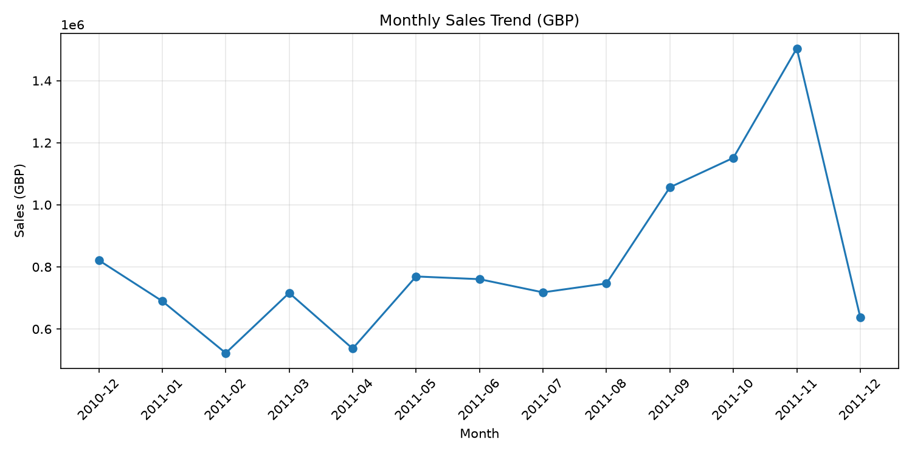

# 电商销售数据分析结论

## 1. 总体指标

数据说明：基于清洗后的 524,877 行明细（清洗规则见 `数据清洗规则.md`），
统计周期 2010-12-01 至 2011-12-09。

| 指标 | 数值            |
|---|---------------|
| 总销售额 | £10,631,048.74 |
| 订单数 | 19,959        |
| 客户数（有 ID） | 4,338         |
| 商品数 | 3,811         |
| 客单价 | £532.64       |

**客单价 532.64 英镑对零售而言偏高**：该零售商客户中批发商占比大
（数据集说明：Many customers of the company are wholesalers），
单次采购量远超普通零售客户。
## 2.月度销售趋势

数据范围：2010-12 至 2011-12，共13个月

结论：
1. **11月是全年峰值**（£1,503,866），是全年最低的二月（£522,546）的**2.9倍**。
   符合英国圣诞采购季特征——批发商提前一到两个月备货
2. **9-11 月连续三个月攀升**（106 万 → 115 万 → 150 万），
   说明旺季从 9 月就开始了，不是 11 月才开始。

3. **⚠️ 2011-12 只有 9 天数据**（截至 12 月 9 日），
   不能与完整月份直接比较。图上看到的"断崖"是数据边界造成的假象，
   不是销售恶化。

图表文件：[monthly_sales_trend.png](../reports/figures/monthly_sales_trend.png)
## 3. 畅销商品

说明：已用正则 `^\d{5}[A-Za-z]{0,3}$` 剔除 POST / DOT / M 等记账用特殊编码，
只统计真实商品。

| 排名  | 商品名 | 销售额(£) | 销量(件) | 均价(£) |
|-----|---|---|---|---|
| 1   | REGENCY CAKESTAND 3 TIER | 174,157 | 13,851 | 12.57 |
| 2   | PAPER CRAFT , LITTLE BIRDIE | 168,470 | 80,995 | 2.08 |
| 3   | WHITE HANGING HEART T-LIGHT HOLDER | 104,463 | 37,641 | 2.78 |
| 4   | PARTY BUNTING | 99,445 | 18,283 | 5.44 |
| 5   | JUMBO BAG RED RETROSPOT | 94,160 | 48,371 | 1.95 |
| 6   | MEDIUM CERAMIC TOP STORAGE JAR | 81,701 | 78,033 | 1.05 |
| 7   | RABBIT NIGHT LIGHT | 66,870 | 30,739 | 2.18 |
| 8   | PAPER CHAIN KIT 50'S CHRISTMAS | 64,876 | 19,329 | 3.36 |
| 9   | ASSORTED COLOUR BIRD ORNAMENT | 58,928 | 36,362 | 1.62 |
| 10  | CHILLI LIGHTS | 54,096 | 10,302 | 5.25 |

结论：
1. **商品分三层**：高价品撑利润、中价品走量、低价品引流。
2. 三层蛋糕架（£12.57）靠高单价登顶销售额；
   纸艺小鸟（£2.08）量价双高，是真正的"爆款"；
   二战滑翔机（£0.25）靠 5.5 万件走量，但销售额榜进不了前 10。
## 4. 客户消费分析

（基于 4,338 个有客户 ID 的客户）

| 指标 | 数值 |
|---|---|
| 客户总数 | 4,338 |
| 平均消费 | £2,048.69 |
| 中位消费 | £668.57 |
| 复购客户（≥2 单） | 2,845（65.6%） |

结论：
1. 客户价值分布极度不均：平均消费 £2,048，中位数仅 £668，标准差高达 £8,985，
   呈典型的长尾（右偏）分布。
2. **二八定律实证**：前 20% 客户（867 人）贡献了 74.7% 的收入。
3. 复购率 65.6%，对批发型零售而言属正常水平。
## 5. RFM 客户分层

基于 4,338 个有客户 ID 的客户，R/F/M 各按中位数分高/低。

| 客户类型 | 人数 | 人均消费 | 总收入 |
|---|---|---|---|
| 重要价值客户 | 1,426 | £4,760 | £6,787,142 |
| 重要保持客户 | 596 | £1,915 | £1,141,553 |
| 流失客户 | 1,007 | £256 | £258,158 |
| 重要挽留客户 | 119 | £1,920 | £228,518 |
| 一般保持客户 | 428 | £409 | £175,246 |
| 一般价值客户 | 395 | £429 | £169,279 |
| 新客户 | 339 | £269 | £91,190 |
| 重要发展客户 | 28 | £1,290 | £36,124 |

结论：
1. **重要价值客户（32.9%）贡献了 76% 的收入**，客户价值高度集中。
2. 重要挽留客户（119 人）曾经高消费但已流失，是挽回重点。
3. 流失客户占 23% 人头、收入不足 3%，不应再投入营销资源。